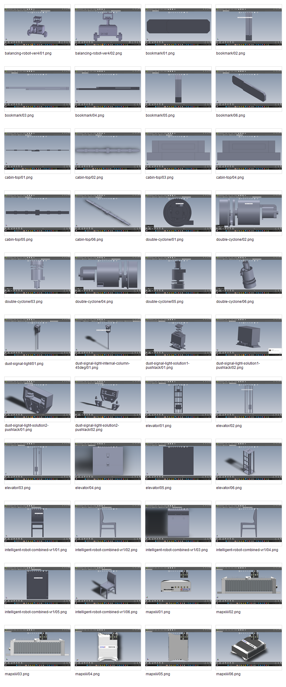
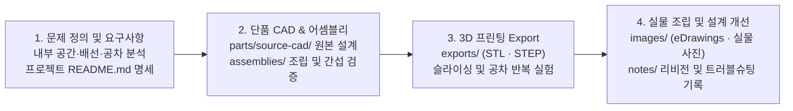
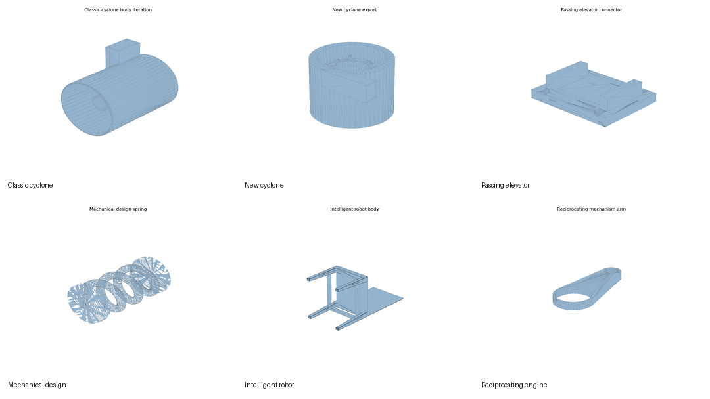

<div align="center">

# 3D Modeling & Printing Engineering Portfolio

**Project-centric CAD, Assembly, STEP/STL Export, and 3D Printing Iteration Archive for Robotics & Mechanical Design.**

로봇 하드웨어, 메커니즘, 케이스 설계 과정에서 도출된 **문제 정의 · 설계 의도 · 원본 CAD(`parts/source-cad`) · 조립품(`assemblies`) · 3D 프린팅 출력물(`exports`) · 실물 검증 사진(`images`)**을 프로젝트 단위로 통합 관리하는 기구설계 포트폴리오 저장소입니다.

[](#capabilities)
[](#how-it-works)
[](#capabilities)
[](https://github.com/yg-gulbi/Self-Balancing-Robot-with-Arduino-and-ROS)

[**Quick Start**](#quick-start) · [**How It Works**](#how-it-works) · [**Capabilities**](#capabilities) · [**Showcases**](#showcases) · [**Directory Spec**](#directory-spec) · [**FAQ**](#faq)

```bash
git clone https://github.com/yg-gulbi/3d-modeling-printing-notes.git && ls portfolio/
```



</div>

---

## Quick Start

### 1) 저장소 클론 및 프로젝트 탐색 (Setup)

저장소를 클론하고 `portfolio/` 하위의 8대 프로젝트 아카이브를 확인합니다.

```bash
# 1. 저장소 클론 및 이동
git clone https://github.com/yg-gulbi/3d-modeling-printing-notes.git
cd 3d-modeling-printing-notes

# 2. 프로젝트별 독립 포트폴리오 디렉토리 목록 확인
ls -la portfolio/
```

### 2) 핵심 실행 — 프로젝트별 조립품 및 3D 프린팅 STL 열람 (Run)

파일 확장자별로 폴더를 오갈 필요 없이, 원하는 프로젝트 폴더 하나로 진입하면 설계 의도(`README.md`), 조립품(`assemblies/`), 출력용 `STL/STEP`(`exports/`), 프리뷰 이미지(`images/`)를 즉시 열람할 수 있습니다.

```bash
# 예시 1: 밸런싱 로봇 보드 플레이트·센서 케이스·배터리 배치 확인
ls portfolio/balancing-robot/exports/ portfolio/balancing-robot/images/

# 예시 2: 미세먼지 신호등 내부 공간 개선 및 Push-Latch 기구 설계 확인
ls portfolio/dust-signal-light/assemblies/ portfolio/dust-signal-light/notes/
```

### 3) 전체 모델 프리뷰 시트 한눈에 보기 (Control)

전체 프로젝트의 어셈블리 및 단품 모델 프리뷰는 `portfolio/_overview/images/`의 컨택트 시트에서 한눈에 비교할 수 있습니다.

```bash
# 전체 어셈블리·모델·eDrawings 캡처 요약 시트 확인
ls portfolio/_overview/images/
```

---

## How It Works

기존의 확장자별 분산 구조(`models/`, `images/`, `projects/` 분리)를 폐기하고, **문제 정의부터 CAD 모델링, 어셈블리 간섭 검토, 3D 프린팅 출력 및 실물 조립 피드백까지 단일 프로젝트 폴더 안에서 완결**되는 4단계 엔지니어링 아카이빙 파이프라인입니다.



---

## Capabilities

| 대상 프로젝트 (Target Project) | 포함 설계 자산 및 반환 결과 (What It Contains) | 핵심 엔지니어링 과제 및 링크 (Engineering Focus & Link) |
| :--- | :--- | :--- |
| **Balancing Robot** | 보드 플레이트, IMU/센서 케이스, 배터리·제어기 마운트 CAD 및 STL | 실물 2륜 밸런싱 로봇 전장 배치 최적화 및 진동·충격 보호 ([portfolio/balancing-robot/](portfolio/balancing-robot/)) |
| **Dust Signal Light** | 신호등 하우징, 내부 격벽, Push-Lock / Push-Latch 개폐 기구 | 협소한 내부 배선 공간 부족 해결 및 무나사 개폐 구조 반복 실험 ([portfolio/dust-signal-light/](portfolio/dust-signal-light/)) |
| **Cyclone Systems** | 일반·신형·이중(Dual) 사이클론 집진기 챔버 및 유로 설계 | 원심 분리 유동 경로 개선을 위한 다단계 형상 리비전 ([portfolio/cyclone-systems/](portfolio/cyclone-systems/)) |
| **Passing Elevator** | 엘리베이터 캐빈, 가이드 레일 및 리니어 구동 기구부 어셈블리 | 수직 리니어 이동 메커니즘 및 캐빈 간섭 검토 ([portfolio/passing-elevator/](portfolio/passing-elevator/)) |
| **Intelligent Chair** | 지능형 로봇 공모전 계열 의자형 메인 바디, 센서 마운트, 외장 케이스 | 다중 센서 시야각 확보 및 하중 지지 프레임 설계 ([portfolio/intelligent-chair/](portfolio/intelligent-chair/)) |
| **MAPXIII** | MAPXIII 로봇 전체 어셈블리 및 하위 구동 부품 CAD | 다부품 로봇 시스템 통합 조립성(DFA) 검증 ([portfolio/mapxiii/](portfolio/mapxiii/)) |
| **Mechanical Design Exercises** | 끼워맞춤 공차, 스프링, 4절 링크, 판 부착장치 등 요소 설계 | 3D 프린팅 수축률을 고려한 실전 공차(Clearance) 실험 ([portfolio/mechanical-design-exercises/](portfolio/mechanical-design-exercises/)) |
| **Utility & Mechanism Models** | 왕복기관(Reciprocating Engine), 운동기구, 생활 밀착형 기구물 | 크랭크-커넥팅로드 회전·직선 변환 기구학 실습 ([portfolio/utility-and-mechanism-models/](portfolio/utility-and-mechanism-models/)) |

---

## Showcases

### 1. 파일 종류별 파편화 해소 및 프로젝트 완결형(Self-Contained) 아키텍처 전환
- **기존 문제점**: 과거 구조에서는 조립품(`models/assemblies`), 단품(`models/source-cad`), 캡처(`images`), 문서(`projects`)가 서로 다른 루트 폴더에 흩어져 있어 단일 기구의 설계 변경 이유와 실제 형상을 대조하려면 4개 디렉토리를 왕복해야 했음.
- **개선 결과**: **8개 핵심 프로젝트 단위**로 모든 엔지니어링 맥락(`README.md` + `assemblies/` + `parts/source-cad/` + `exports/` + `images/` + `notes/`)을 1:1 캡슐화하여 탐색 깊이와 맥락 전환 비용을 최소화했습니다.

<p align="center">
  
</p>

---

## Directory Spec

### 프로젝트 폴더 내부 표준 규격

| 하위 폴더 / 파일 | 수록 파일 형식 | 역할 및 설명 |
| :--- | :--- | :--- |
| `README.md` | Markdown (`.md`) | 해당 기구의 설계 목적, 발생한 문제(공간 부족, 간섭 등), 치수 및 구조 변경 판단 근거 |
| `assemblies/` | `.SLDASM`, `.CATProduct` | SolidWorks / CATIA 전체 조립품 엔트리 파일 |
| `parts/source-cad/` | `.SLDPRT`, `.CATPart` | 조립품을 구성하는 개별 부품의 파라메트릭 원본 CAD 파일 |
| `exports/` | `.STL`, `.STEP`, `.IGES` | 3D 프린터 슬라이서 즉시 투입용 메쉬(`STL`) 및 범용 CAD 호환 파일(`STEP`) |
| `images/` | `.png`, `.jpg` | eDrawings 단면/조립 캡처, 렌더링 프리뷰, 실제 3D 프린팅 출력물 조립 사진 |
| `notes/` | `.md`, `.pdf`, `.txt` | 리비전별 공차 수정 기록, 마운트 개선 노트 및 발표/검토 자료 |

---

## FAQ

<details>
<summary><b>SolidWorks나 CATIA가 설치되어 있지 않아도 모델을 확인할 수 있나요?</b></summary>

가능합니다. 각 프로젝트 폴더의 `images/`에 다각도 eDrawings 캡처와 실물 사진이 수록되어 있으며, `exports/` 폴더의 `.STL` 및 `.STEP` 파일은 GitHub 내장 3D 뷰어나 무료 뷰어(FreeCAD, Blender, Cura 등)에서 즉시 열람할 수 있습니다.
</details>

<details>
<summary><b>밸런싱 로봇 기구물이 실제로 탑재된 로봇 제어 코드는 어디에 있나요?</b></summary>

`portfolio/balancing-robot/`에 수록된 보드 플레이트와 센서 케이스가 실제 적용된 펌웨어 및 ROS 시뮬레이션 코드는 [Self-Balancing-Robot-with-Arduino-and-ROS](https://github.com/yg-gulbi/Self-Balancing-Robot-with-Arduino-and-ROS) 저장소에서 확인할 수 있습니다.
</details>

<details>
<summary><b>루트의 archive/ 폴더는 어떤 용도인가요?</b></summary>

`archive/`에는 프로젝트 중심 구조(`portfolio/`)로 재편하는 과정에서 단일 프로젝트로 귀속하기 모호한 초기 혼합 소스나 이전 파일 매니페스트를 추적 및 보존 목적으로 격리해 두었습니다.
</details>
